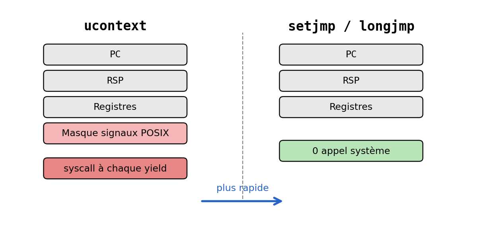
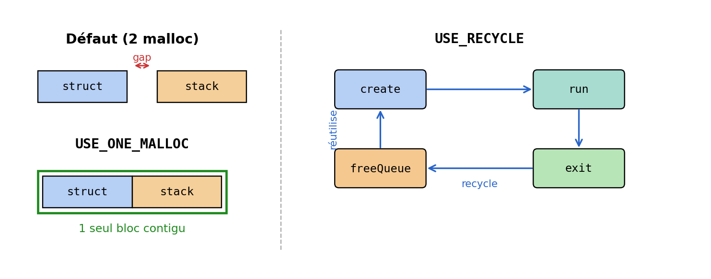
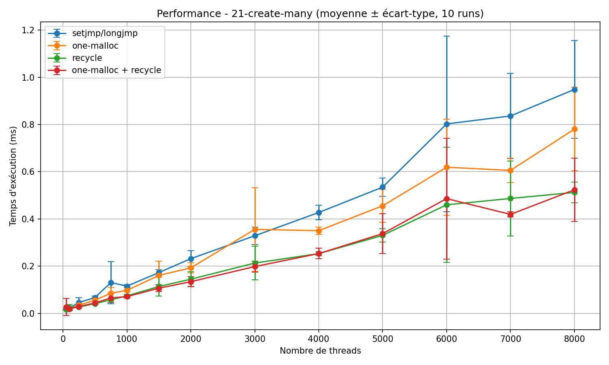
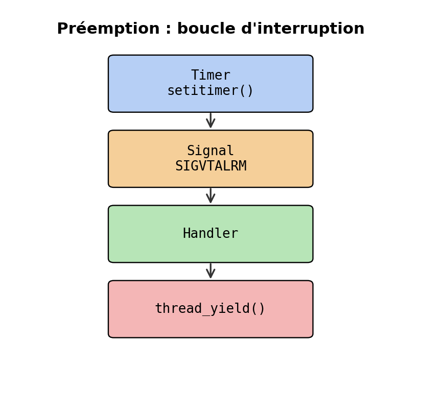
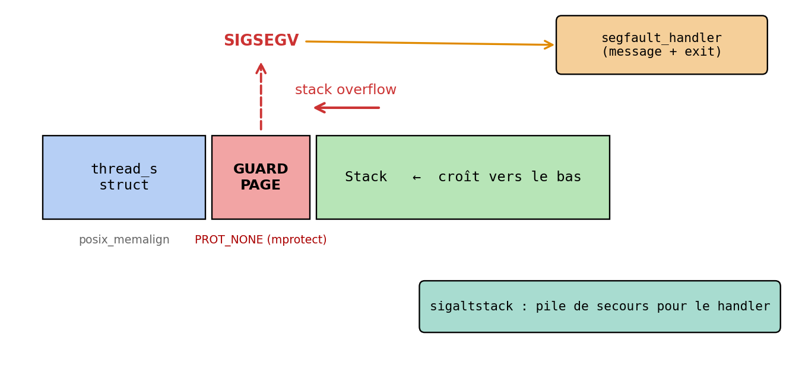
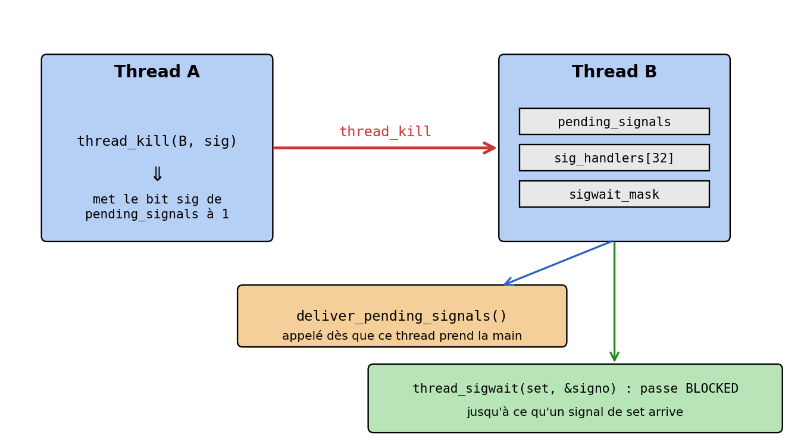
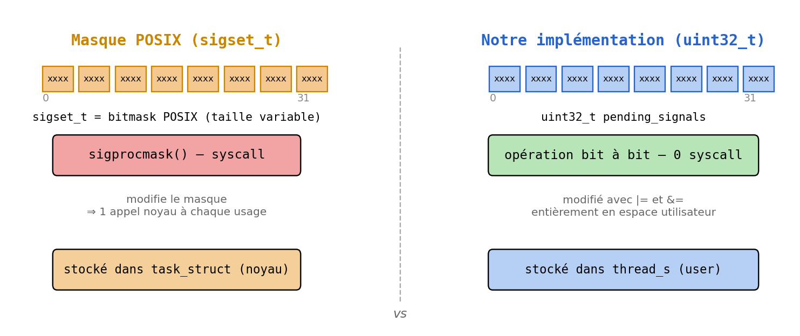
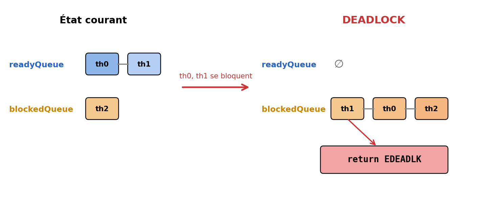

# Bibliotheque de Threads Utilisateur (User-Level Threads)

Ce projet propose l'implementation complete d'une bibliotheque de gestion de threads en C. Elle permet la creation, l'ordonnancement, et la destruction de threads legers.

Outre les fonctionnalites de base, ce projet integre plusieurs objectifs avances, activables via des options de compilation : optimisations memoire (one-malloc, recycle), changement de contexte via ucontext, gestion de priorites, ordonnancement preemptif, protection contre les depassements de pile, signaux inter-threads en espace utilisateur, et detection de deadlocks.


## Architecture du Projet

```
.
├── src/            # Code source de la bibliotheque
├── test/           # Fichiers de test
├── install/        # Genere automatiquement a la compilation
│   ├── lib/        # Bibliotheques statiques compilees
│   └── bin/        # Executables de tests compiles
├── scripts/        # Scripts annexes (plot.py pour les graphes de performances)
├── results/        # Figures generees par le script Python
├── docs/           # Illustrations utilisees dans ce README
├── rapport/        # Fichiers source LaTeX pour le rapport intermediaire
├── rapport-final/  # Fichiers source LaTeX pour le rapport final
├── slides/         # Sources LaTeX de la presentation
├── Makefile        # Fichier de regles de compilation
└── README.md
```


## Compilation et Options

La compilation s'effectue via make. Le systeme genere plusieurs versions de la bibliotheque dans install/lib/ et compile les tests correspondants dans install/bin/.

### Version par defaut (optimisee)
La version par defaut est compilee avec les deux optimisations memoire activees (-DUSE_ONE_MALLOC -DUSE_RECYCLE). C'est la version la plus performante.
* Commande : `make all` ou `make build_tests`

### setjmp/longjmp sans optimisations (reference pour benchmarks)
Version de base utilisant uniquement setjmp/longjmp, sans aucune optimisation memoire. Sert de reference pour les mesures de performances.
* Commande : `make setjmp`
* Genere les executables suffixes par -setjmp.

### One-malloc
Alloue la structure du thread et sa pile en un seul bloc memoire contigu, reduisant le nombre d'appels malloc/free de moitie.
* Commande : `make one-malloc`
* Genere les executables suffixes par -one-malloc.

### Recycle
Maintient une file de blocs liberes et les reutilise a la prochaine creation de thread, evitant les appels repetes a malloc/free.
* Commande : `make recycle`
* Genere les executables suffixes par -recycle.

### One-malloc + Recycle
Combinaison des deux optimisations. Version la plus performante pour la creation/destruction de threads.
* Commande : `make one-malloc-recycle`
* Genere les executables suffixes par -one-malloc-recycle.

### Changement de contexte (ucontext)
Remplace setjmp/longjmp par l'API ucontext (getcontext, makecontext, swapcontext).
* Commande : `make context`
* Genere les executables suffixes par -context.

### Ordonnancement Preemptif
Active la preemption via des alarmes virtuelles (SIGVTALRM via setitimer). Les threads sont interrompus automatiquement sans avoir besoin d'appeler thread_yield() explicitement. Les sections critiques sont protegees par masquage des signaux.
* Commande : `make preem`
* Genere les executables suffixes par -preem.

### Ordonnancement par Priorite
Active une file d'attente triee par priorite avec vieillissement pour eviter la famine.
* Commande : `make priority`
* Genere les executables suffixes par -priority.

### Protection de la Pile (Stack Guard)
Ajoute une page de protection sans droits d'acces a la fin de la pile de chaque thread via mprotect. En cas de debordement, un gestionnaire sur une pile alternative (sigaltstack) intercepte proprement le SIGSEGV.
* Commande : `make stackprot`
* Genere les executables suffixes par -stackprot.

### Signaux inter-threads en espace utilisateur
Implemente des signaux cooperatifs purement en espace utilisateur (sans signaux POSIX). Expose thread_kill, thread_signal et thread_sigwait. Compatible avec setjmp/longjmp et ucontext.
* Commande : `make signals`
* Genere les executables suffixes par -signals.

### Tout compiler
Pour compiler toutes les bibliotheques et toutes les declinaisons des tests :
* Commande : `make install`


## Execution des Tests

* Lancer les tests de la version standard : `make check`
* Lancer TOUTES les versions des tests : `make check_all`
* Verifier les fuites memoire avec Valgrind : `make valgrind`
* Lancer le test specifique aux signaux : `make signals`


## Idees cles illustrees

Les figures ci-dessous reprennent les schemas de la presentation orale (dossier `slides/`).


### 1. Changement de contexte : `setjmp/longjmp` vs `ucontext`



Les deux mecanismes sauvegardent la meme information utile a la reprise (PC, RSP, registres callee-saved), mais `ucontext` sauvegarde en plus le masque de signaux POSIX. Or ce masque vit dans le `task_struct` du noyau : chaque `getcontext` / `swapcontext` declenche donc un `sigprocmask`, c'est-a-dire un appel systeme. `setjmp` / `longjmp`, eux, ne touchent que des registres en espace utilisateur et n'entrainent **aucun** appel systeme. Sur nos benchmarks de commutation, l'ecart est constant et important - c'est la raison pour laquelle la version par defaut utilise `setjmp/longjmp`.


### 2. Optimisations memoire : `one-malloc` et `recycle`



La version par defaut fait deux `malloc` par thread : un pour la structure `thread_s`, un pour la pile. `USE_ONE_MALLOC` fusionne les deux en un seul bloc contigu : moitie moins d'appels a l'allocateur, moins de fragmentation, meilleure localite cache. `USE_RECYCLE` va plus loin : au lieu de rendre les blocs a la libc a chaque `thread_exit`, on les pousse dans une `freeQueue` et le prochain `thread_create` les repioche. Sur `21-create-many`, la combinaison des deux ecrase la version de reference car le chemin critique de creation n'appelle plus du tout `malloc` en regime etabli.




### 3. Preemption : boucle Timer -> Signal -> Handler -> yield



Le mode cooperatif oblige chaque thread a appeler `thread_yield()` : un thread malveillant ou en boucle serree monopolise le CPU. Le mode preemptif arme un timer virtuel via `setitimer(ITIMER_VIRTUAL, ...)`. A l'expiration, le noyau delivre `SIGVTALRM` au processus, notre handler est execute, et il appelle `thread_yield()` a la place du thread interrompu. Les manipulations de `readyQueue`, `blockedQueue` et `currentThread` doivent alors etre protegees par `lock_preemption()` / `unlock_preemption()` (compteur de blocage, pas de syscall) pour eviter la corruption des files chainees.


### 4. Protection de pile (`USE_STACK_PROT`)



Les piles de threads sont allouees dans le tas : un depassement corrompt silencieusement la memoire du thread voisin, et les bugs qui en decoulent sont pratiquement impossibles a diagnostiquer. On aligne donc l'allocation sur une page (`posix_memalign`), on marque la page situee juste avant la pile en `PROT_NONE` via `mprotect`, et tout debordement declenche `SIGSEGV`. Le handler ne peut pas s'executer sur la pile fautive : on installe une pile alternative via `sigaltstack`, il affiche un message clair (numero du thread, cause) puis termine proprement. Validation : test `90-stack_overflow`.


### 5. Signaux inter-threads en espace utilisateur



Contrairement aux signaux POSIX qui vivent au niveau du processus, nos signaux vivent au niveau de chaque thread. Chaque `thread_s` porte trois champs : `pending_signals` (bitmask des signaux en attente), `sig_handlers[32]` (les handlers), et `sigwait_mask` (les signaux qu'attend un `thread_sigwait`). `thread_kill(B, sig)` est purement local : il met a jour un bit dans la structure de B, aucun syscall. Les handlers sont declenches par `deliver_pending_signals()`, appele juste apres qu'un thread reprend la main dans `thread_yield`. Un thread qui appelle `thread_sigwait(set, &signo)` bascule en `BLOCKED` jusqu'a ce qu'un `thread_kill` transporte un signal de `set`, moment ou il est reveille et `signo` est renseigne.

Le choix de `uint32_t` (et pas `sigset_t`) n'est pas cosmetique :



`sigset_t` est un opaque de taille variable, manipule uniquement via `sigprocmask` - un syscall par appel. Un `uint32_t` est un mot machine, manipule avec `|=` et `&=` : aucune barriere utilisateur/noyau, pas de contention avec le scheduler POSIX, et exactement 32 bits garantis par le standard C - ce qui donne un numero de signal stable independamment de l'architecture.


### 6. Detection de deadlock



Un `thread_join` classique bascule le thread appelant en `BLOCKED` en attendant que la cible termine. Mais si la `readyQueue` est deja vide et que le thread appelant s'ajoute a la `blockedQueue`, plus personne ne pourra jamais le reveiller : c'est un deadlock structurel. On detecte le cas au moment ou l'appelant s'apprete a se bloquer et on renvoie `EDEADLK` au lieu de figer le processus. Test dedie : `81-deadlock`.


## Performances

* Generer les graphiques de performances : `make graphs`

Compare quatre variantes (setjmp/longjmp, one-malloc, recycle, one-malloc+recycle) ainsi que ucontext et pthreads sur deux tests : creation/destruction de threads et changements de contexte. Chaque mesure est repetee 10 fois sur un seul coeur (taskset -c 0). Les resultats sont stockes dans results/.

* Compiler le rapport final : `make rapport-final`


## Nettoyage

Supprime tous les fichiers generes (objets, bibliotheques, executables, fichiers LaTeX temporaires, et figures dans results/) :
* Commande : `make clean`
